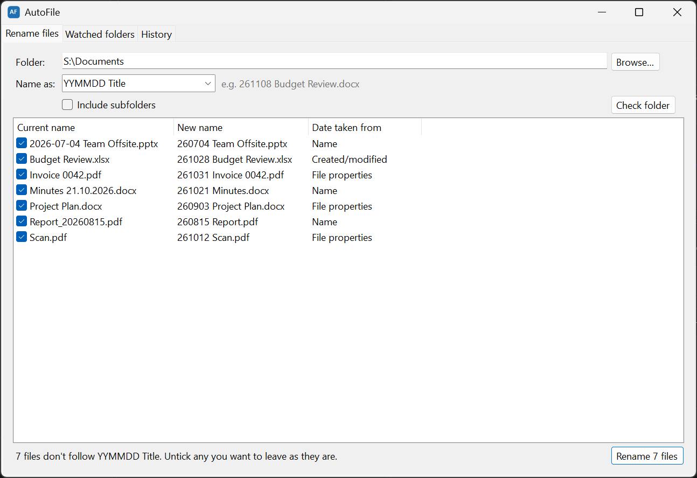
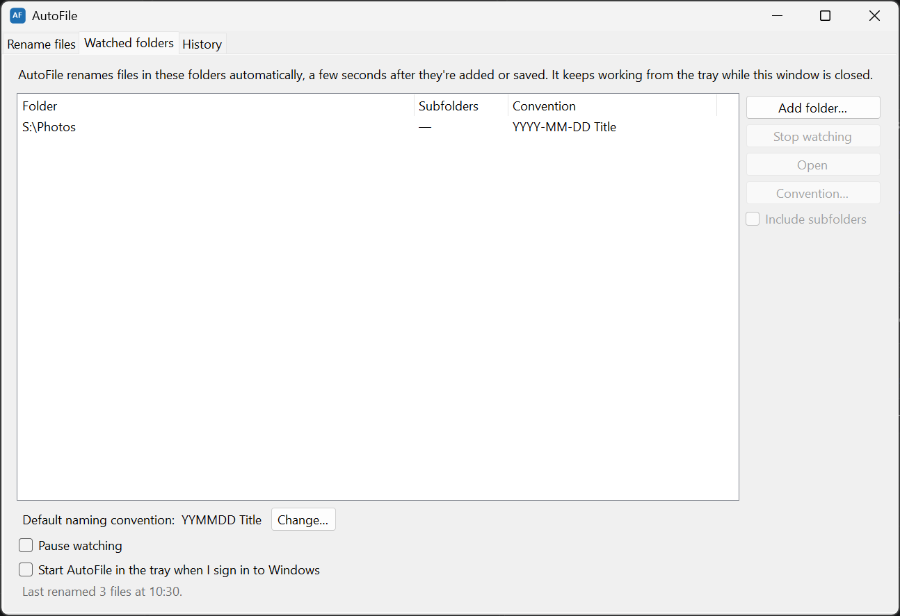
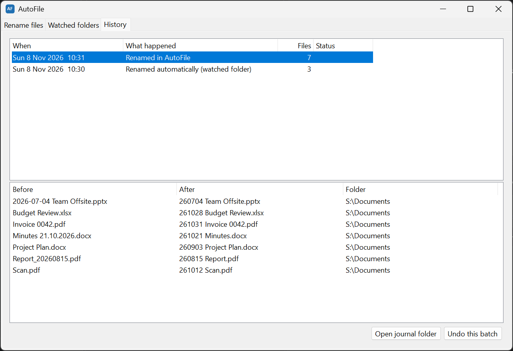

# AutoFile

I name my files `YYMMDD Title`, so every folder sorts by date. Keeping that up by hand meant working out each file's date and retyping its name. AutoFile does it for me: it finds the right date, renames the file, and keeps doing it in the folders I tell it to watch.



## What is it?

A Windows app that renames files to a date-based naming convention, **`YYMMDD Title`** by default: `Budget Review.xlsx` becomes `251102 Budget Review.xlsx`. You preview every rename before it happens, and every rename can be undone.

**Download:** [the latest release](https://github.com/tnoahc/AutoFile/releases/latest)

## Why this exists

A date at the front of a file name is a simple filing system. It sorts by date anywhere files are sorted by name, and it doesn't depend on a program or a database. The hard part is keeping it up. The right date is often hidden: in a photo's EXIF data, in a Word document's properties, or in a different date format that's already in the name. And Windows resets a file's *created* date whenever it's copied or downloaded, so the date Explorer shows is often the wrong one.

## Current state

Version 1.0.0, released as a zip with two self-contained exes for 64-bit Windows. There's no installer and no .NET runtime to install. Settings and history live in a folder beside the exes, so the whole thing is portable. It's tested on Windows 11 Pro: the 48 automated tests pass, and the screenshots here are from the release build.

**What works:**

| Feature | Status |
| --- | --- |
| Rename a folder (and optionally its subfolders) with a preview first | ✅ |
| Eight built-in naming conventions, or write your own | ✅ |
| A different convention per folder, converting files already named in another one | ✅ |
| Dates from the file name, photo/video/Office/PDF metadata, or file timestamps | ✅ |
| Watched folders, renamed automatically from the tray | ✅ |
| Undo any batch of renames, with full history in a git repo | ✅ |
| Command-line tool | ✅ |
| Editing ignore patterns and timings in the app | ❌ (edit `config.json`, see [Settings](#settings)) |
| macOS and Linux | ❌ |

For example, with the default convention, `IMG_20240315_1234.jpg` becomes `240315 IMG_1234.jpg`, and `Scan.pdf` gets the creation date stored inside the PDF.

## How it works

For each file, AutoFile picks a date in this order. The preview's **Date taken from** column shows which one it used.

1. **A date already in the name** (*Name*). It recognises every preset and configured convention, plus names like `2024-03-15 Notes`, `Report_20240315`, `IMG_20240315_1234`, `Minutes 15.03.2024` (day first) and `240315_Plan`. The old date is taken out of the title.
2. **Metadata inside the file** (*File properties*). This covers the photo or video "date taken" (EXIF/QuickTime), the Office "created" property (docx, xlsx, pptx and so on), and the PDF creation date.
3. **File timestamps** (*Created/modified*). It uses the earlier of *created* and *modified*. Because Windows resets *created* when a file is copied or downloaded, *modified* is often the truer date.

If nothing is left of the title once the date is removed (a photo named `20240315.jpg`, say), the title becomes `Untitled`.

A file is left alone if its name already follows the convention that applies to it, with a real date. Hidden and system files, Office lock files (`~$…`), partial downloads, shortcuts and anything inside `.git` are skipped. If the new name is taken, ` (2)`, ` (3)` and so on is added. Existing files are never overwritten.

Watched folders use the Windows file system events. A new or changed file is renamed once it's been untouched for 5 seconds and isn't open in another program. A full sweep every 15 minutes catches anything the events missed.

Every batch of renames is a commit in a git repo, `AutoFile.data\journal`. Each batch is one JSON file, and the commit message lists `old path -> new name`. Undo restores the names and records the reversal as its own commit. The watcher doesn't rename files that an undo restored, but an explicit `scan --apply` still will. You can browse the history with any git tool, for example `git -C AutoFile.data\journal log --stat`.

## Setup

1. Download `AutoFile-<version>-win-x64.zip` from [the latest release](https://github.com/tnoahc/AutoFile/releases/latest).
2. Extract it anywhere and run `AutoFileApp.exe`.
3. On the **Rename files** tab, choose a folder, pick a convention in **Name as**, and click **Check folder**. Untick anything you want to leave alone, then click **Rename**.
4. To keep a folder tidy from now on, go to **Watched folders** and click **Add folder…**.

The zip contains:

| File | What it is |
| --- | --- |
| `AutoFileApp.exe` | The app: a window for renaming, plus the background watcher in the tray |
| `autofile.exe` | Command-line tool (optional) |

On first run, AutoFile creates `AutoFile.data\` beside the exes, holding `config.json` (watched folders, ignore patterns, timings) and `journal\` (the git repo recording every rename).

## Naming conventions

A convention is written the way you'd describe it: a date made of `YYYY` or `YY`, `MM` and `DD` (optionally separated by `-`, `_`, `.` or a space), the word `Title`, and any fixed text around them.

These presets are built in:

| Convention | Example |
| --- | --- |
| `YYMMDD Title` (default) | `251102 Budget Review.docx` |
| `YYYY-MM-DD Title` | `2025-11-02 Budget Review.docx` |
| `YYYYMMDD Title` | `20251102 Budget Review.docx` |
| `YYYYMMDD_Title` | `20251102_Budget Review.docx` |
| `YYYY-MM-DD - Title` | `2025-11-02 - Budget Review.docx` |
| `DD-MM-YYYY Title` | `02-11-2025 Budget Review.docx` |
| `Title - YYYY-MM-DD` | `Budget Review - 2025-11-02.docx` |
| `Title_YYYYMMDD` | `Budget Review_20251102.docx` |

You can also write your own:

| Convention | Example |
| --- | --- |
| `Title - DD.MM.YYYY` | `Budget Review - 02.11.2025.docx` |
| `[YYYY.MM.DD] Title` | `[2025.11.02] Budget Review.docx` |

There's one **default** convention, and any watched folder can set its **own**. For example, Photos can use `YYYY-MM-DD Title` while Documents keeps `YYMMDD Title`. Files already named in a different recognised convention are **converted**: switching a folder to `YYYY-MM-DD Title` turns `240315 Report` into `2024-03-15 Report`.

## The app

The window has three tabs:

- **Rename files**: choose a folder (Browse, paste a path, or drag a folder onto the window) and pick a convention in **Name as**. That's a preset or one you type, and a live example shows the result. Tick **Include subfolders** if you want, then click **Check folder**. You'll see each file's current name, new name, and where the date came from. Untick anything you want to leave alone, then click **Rename**. An **Undo** button appears straight afterwards. Choosing a watched folder brings up its own convention.
- **Watched folders**: click **Add folder…** to have AutoFile keep a folder tidy. You can watch it straight away or preview it first. Select a folder and click **Convention…** to give it its own convention, or use **Change…** next to *Default naming convention*. You're asked to confirm first, because the watcher will then rename that folder's files to match. This tab also has **Pause watching** and **Start AutoFile in the tray when I sign in to Windows** (a per-user startup entry, no admin rights needed).

  

- **History**: every batch of renames, whether from the window, the watcher or the command line. Select one to see its files, and click **Undo this batch** to put the names back.

  

Closing the window keeps AutoFile running in the tray while any folders are watched. Double-click the **AF** tray icon to reopen it, or right-click it to pause, undo or exit. If nothing is watched, closing the window quits.

Launching the exe again brings the existing window forward. `AutoFileApp.exe "C:\some\folder"` opens with that folder ready to check, and `AutoFileApp.exe --minimized` starts in the tray without opening the window (the sign-in startup entry uses this).

## Command line

```text
autofile scan <folder> [--recursive] [--convention "<c>"]   preview what would be renamed
autofile scan <folder> ... --apply                          rename them
autofile undo [<batch-id>]                                  undo the last batch (or a specific one)
autofile history [--limit <n>]                              list recent batches
autofile folders add <folder> [--recursive] [--convention "<c>"]
                                                            watch a folder
autofile folders remove <folder>
autofile folders [list]
autofile convention                                         show the default and the presets
autofile convention set "<c>"                               change the default
autofile watch                                              run the watcher in a console window
autofile config                                             show where config and journal live
autofile help                                               show usage
```

Without `--convention`, `scan` uses the folder's watched convention if it has one, otherwise the default. `-r` is short for `--recursive` and `-n` for `--limit`. `history` shows the last 20 batches by default. The app picks up folder changes made with `autofile folders …` while it's running.

## Settings

Settings are in `AutoFile.data\config.json`:

| Key | Default | Meaning |
| --- | --- | --- |
| `Convention` | `YYMMDD Title` | Default naming convention |
| `WatchedFolders` | `[]` | `{ "Path": "...", "Recursive": false, "Convention": null }` entries (`null` = use the default) |
| `IgnorePatterns` | see file | Wildcards matched against file names |
| `UseMetadataDates` | `true` | Read EXIF/Office/PDF dates |
| `StableSeconds` | `5` | Quiet time before the watcher renames a file |
| `RescanMinutes` | `15` | Interval between full sweeps |

## What's next

Ideas I'm considering. Tell me which would be most useful:

- Ignore patterns, timings and the metadata option in the app, instead of only in `config.json`
- A code-signed release, so Windows doesn't warn on first run
- A build for Windows on Arm (releases are currently `win-x64` only)

## Caveats

- **Windows only.** It relies on Windows file system events and WinForms.
- **The exes aren't code-signed.** Windows SmartScreen may say "Windows protected your PC" the first time you run them. Click **More info → Run anyway**.
- **Dates with separators after the day are read day first.** `03.04.2024` and `03-04-2024` mean 3 April 2024, not 4 March.
- **File timestamps can mislead.** A file with no date in its name or metadata gets the earlier of its created and modified dates, which may be when it was copied rather than written. Check the preview before renaming.
- **Undo works by path.** If you've moved or renamed a file since AutoFile renamed it, or something else now has its old name, undo skips that file and tells you.
- **Files open in another program wait.** The watcher renames them once they're closed.
- This was developed with AI assistance (Claude).

## Building from source

```powershell
dotnet build
dotnet test
.\publish.ps1
```

You'll need Windows and the [.NET 10 SDK](https://dotnet.microsoft.com/download) (the app targets `net10.0-windows`). Tests use xUnit. `publish.ps1` writes the portable app to `dist\AutoFile\` and the release zip to `dist\`. The version is set in `Directory.Build.props`.

`src/AutoFile.Core` holds all the logic: rules, date detection, planner, journal and watcher. It uses [LibGit2Sharp](https://github.com/libgit2/libgit2sharp) for the journal and [MetadataExtractor](https://github.com/drewnoakes/metadata-extractor-dotnet) for photo and video dates. `src/AutoFile.App` (WinForms window and tray) and `src/AutoFile.Cli` are thin front ends. `tools/make-icon.ps1` regenerates the app icon. Set `AUTOFILE_DATA` to point the apps at a scratch data folder while testing.

Feedback, bug reports and contributions are welcome.
