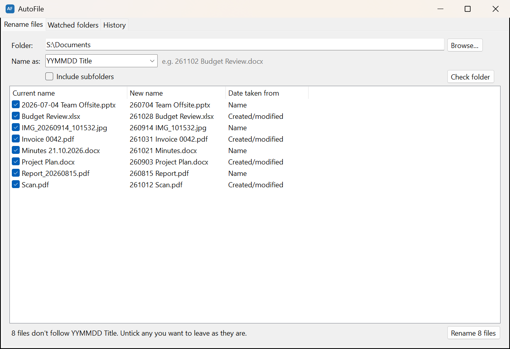

# AutoFile

Keeps folders tidy by renaming files to a date-based naming convention: **`YYMMDD Title`** by default, e.g. `Budget Review.xlsx` → `251102 Budget Review.xlsx`.



**Download:** get the latest `AutoFile-<version>-win-x64.zip` from [Releases](https://github.com/tnoahc/AutoFile/releases), extract it anywhere and run `AutoFileApp.exe`. No install or .NET runtime needed.

## Naming conventions

A convention is written the way you'd describe it: a date made of `YYYY` or `YY`, `MM` and `DD` (optionally separated by `-`, `_`, `.` or a space), the word `Title`, and any fixed text around them.

These presets are built in:

| Convention | Example |
| --- | --- |
| `YYMMDD Title` (default) | `251102 Budget Review.docx` |
| `YYYY-MM-DD Title` | `2025-11-02 Budget Review.docx` |
| `YYYYMMDD Title` | `20251102 Budget Review.docx` |
| `YYYYMMDD_Title` | `20251102_Budget Review.docx` |
| `YYYY-MM-DD - Title` | `2025-11-02 - Budget Review.docx` |
| `DD-MM-YYYY Title` | `02-11-2025 Budget Review.docx` |
| `Title - YYYY-MM-DD` | `Budget Review - 2025-11-02.docx` |
| `Title_YYYYMMDD` | `Budget Review_20251102.docx` |

You can also write your own:

| Convention | Example |
| --- | --- |
| `Title - DD.MM.YYYY` | `Budget Review - 02.11.2025.docx` |
| `[YYYY.MM.DD] Title` | `[2025.11.02] Budget Review.docx` |

If nothing is left of the title once the date is removed (e.g. a photo named `20240315.jpg`), the title becomes `Untitled`.

There's one **default** convention, and any watched folder can set its **own** (e.g. Photos uses `YYYY-MM-DD Title` while Documents keeps `YYMMDD Title`). Files already named in a different recognised convention are **converted**: switching a folder to `YYYY-MM-DD Title` turns `240315 Report` into `2024-03-15 Report`. As always, every rename can be undone.

## How the date is chosen

1. **A date already in the name**: names in any preset or configured convention, plus `2024-03-15 Notes`, `Report_20240315`, `IMG_20240315_1234`, `Minutes 15.03.2024` (day first) and `240315_Plan`. The old date is taken out of the title.
2. **Metadata inside the file**: photo/video "date taken" (EXIF/QuickTime), the Office "created" property (docx/xlsx/pptx…), and the PDF creation date.
3. **File timestamps**: the earlier of *created* and *modified*. Windows resets *created* when a file is copied or downloaded, so *modified* is often the truer date.

A file is left alone if its name already follows the convention that applies to it, with a real date. Hidden/system files, Office lock files (`~$…`), partial downloads, shortcuts and anything inside `.git` are skipped. If the new name is taken, ` (2)`, ` (3)`… is added. Existing files are never overwritten.

## Portable build

```powershell
.\publish.ps1
```

Building needs Windows and the [.NET 10 SDK](https://dotnet.microsoft.com/download). This produces `dist\AutoFile\` with two self-contained exes for 64-bit Windows (no .NET install needed to run them). Copy that folder anywhere. Settings and history live beside the exes in `AutoFile.data\`.

| File | What it is |
| --- | --- |
| `AutoFileApp.exe` | The app: a window for renaming, plus the background watcher in the tray |
| `autofile.exe` | Command-line tool (optional) |
| `AutoFile.data\config.json` | Watched folders, ignore patterns, timings |
| `AutoFile.data\journal\` | Git repo recording every rename |

## The app

Double-click `AutoFileApp.exe`. The window has three tabs:

- **Rename files**: choose a folder (Browse, paste a path, or drag a folder onto the window). Pick a convention in **Name as** (a preset, or type your own; a live example shows the result). Tick **Include subfolders** if you want, then click **Check folder**. You'll see each file's current name, new name, and where the date came from. Untick anything you want to leave alone, then click **Rename**. An **Undo** button appears straight afterwards. A watched folder automatically brings up its own convention.
- **Watched folders**: click **Add folder…** to have AutoFile keep a folder tidy automatically. You can watch it straight away or preview it first. New or changed files are renamed once they've been untouched for 5 seconds and aren't open in another program. Select a folder and click **Convention…** to give it its own convention, or use **Change…** next to *Default naming convention*. You're asked to confirm first, because the watcher will then rename that folder's files to match. This tab also has **Pause watching** and **Start AutoFile in the tray when I sign in to Windows** (a per-user startup entry, no admin rights needed).
- **History**: every batch of renames, whether from the window, the watcher or the command line. Select one to see its files, and click **Undo this batch** to put the names back.

Closing the window keeps AutoFile running in the tray while any folders are watched. Double-click the **AF** tray icon to reopen it, or right-click it to pause, undo or exit. If nothing is watched, closing the window quits. Launching the exe again brings the existing window forward, `AutoFileApp.exe "C:\some\folder"` opens with that folder ready to check, and `AutoFileApp.exe --minimized` starts in the tray without opening the window (this is what the sign-in startup entry uses).

A full sweep runs every 15 minutes to catch anything the file system events missed. Folder changes made with `autofile folders …` are picked up while the app is running.

## Command line

```text
autofile scan <folder> [--recursive] [--convention "<c>"]   preview what would be renamed
autofile scan <folder> ... --apply                          rename them
autofile undo [<batch-id>]                                  undo the last batch (or a specific one)
autofile history [--limit <n>]                              list recent batches
autofile folders add <folder> [--recursive] [--convention "<c>"]
                                                            watch a folder
autofile folders remove <folder>
autofile folders [list]
autofile convention                                         show the default and the presets
autofile convention set "<c>"                               change the default
autofile watch                                              run the watcher in a console window
autofile config                                             show where config and journal live
autofile help                                               show usage
```

Without `--convention`, `scan` uses the folder's watched convention if it has one, otherwise the default. `-r` is short for `--recursive` and `-n` for `--limit`. `history` shows the last 20 batches by default.

## Git journal

Every batch of renames is a commit in `AutoFile.data\journal` (one JSON file per batch, and the commit message lists `old path -> new name`). Undo restores the names and records the reversal as its own commit. Files restored by an undo aren't renamed again by the watcher, but an explicit `scan --apply` will still rename them. You can browse the history with any git tool, e.g. `git -C AutoFile.data\journal log --stat`.

## Settings (`config.json`)

| Key | Default | Meaning |
| --- | --- | --- |
| `Convention` | `YYMMDD Title` | Default naming convention |
| `WatchedFolders` | `[]` | `{ "Path": "...", "Recursive": false, "Convention": null }` entries (`null` = use the default) |
| `IgnorePatterns` | see file | Wildcards matched against file names |
| `UseMetadataDates` | `true` | Read EXIF/Office/PDF dates |
| `StableSeconds` | `5` | Quiet time before the watcher renames a file |
| `RescanMinutes` | `15` | Interval between full sweeps |

## Development

```powershell
dotnet build
dotnet test
```

Requires the .NET 10 SDK on Windows (the app targets `net10.0-windows`). Tests use xUnit.

`src/AutoFile.Core` holds all the logic (rules, date detection, planner, journal, watcher). It uses [LibGit2Sharp](https://github.com/libgit2/libgit2sharp) for the journal and [MetadataExtractor](https://github.com/drewnoakes/metadata-extractor-dotnet) for photo/video dates. `src/AutoFile.App` (WinForms window + tray) and `src/AutoFile.Cli` are thin front ends. `tools/make-icon.ps1` regenerates the app icon. Set `AUTOFILE_DATA` to point the apps at a scratch data folder while testing.
